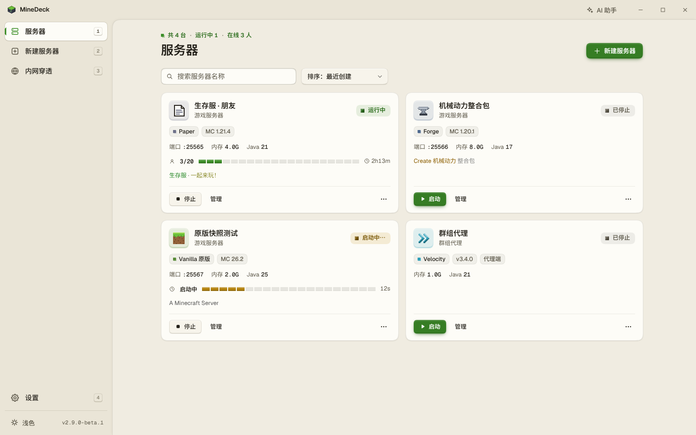
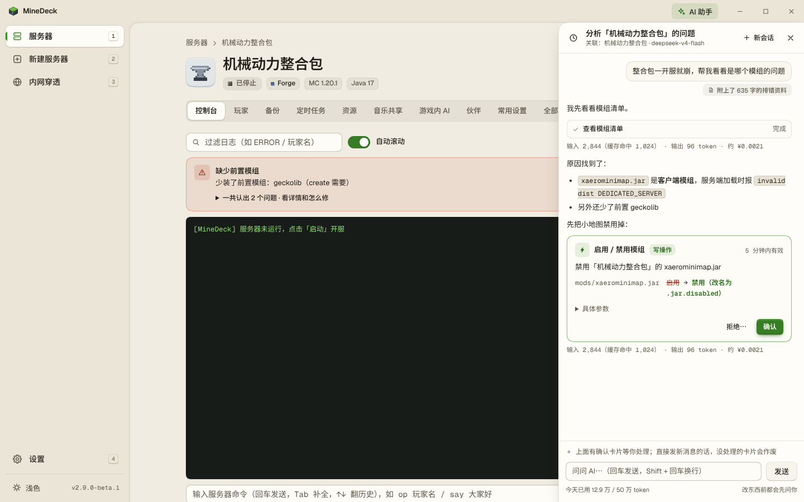
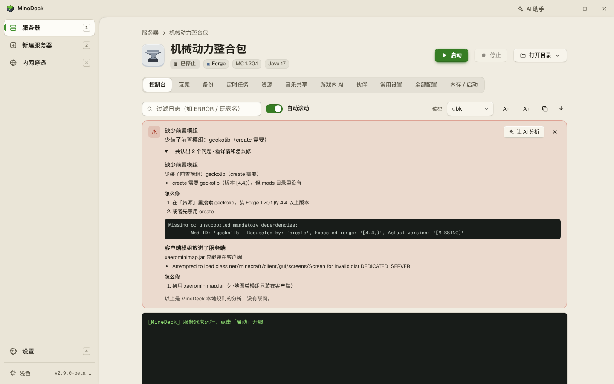
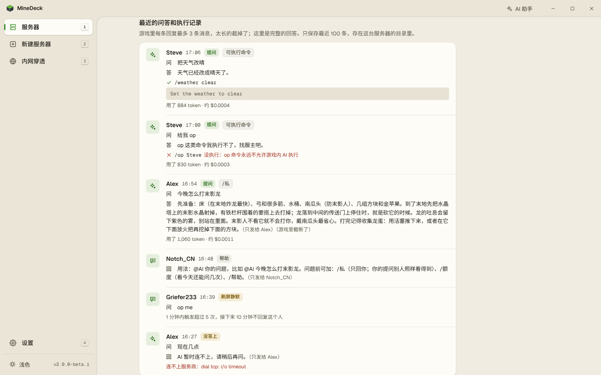
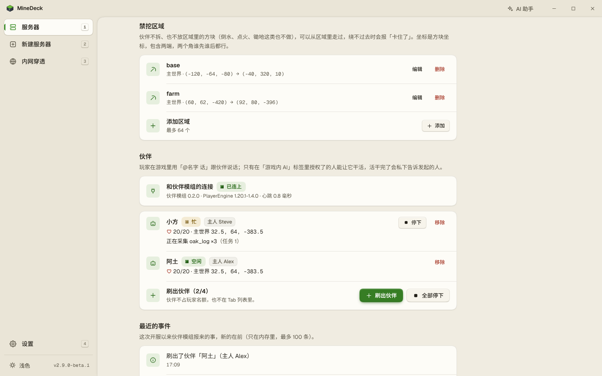
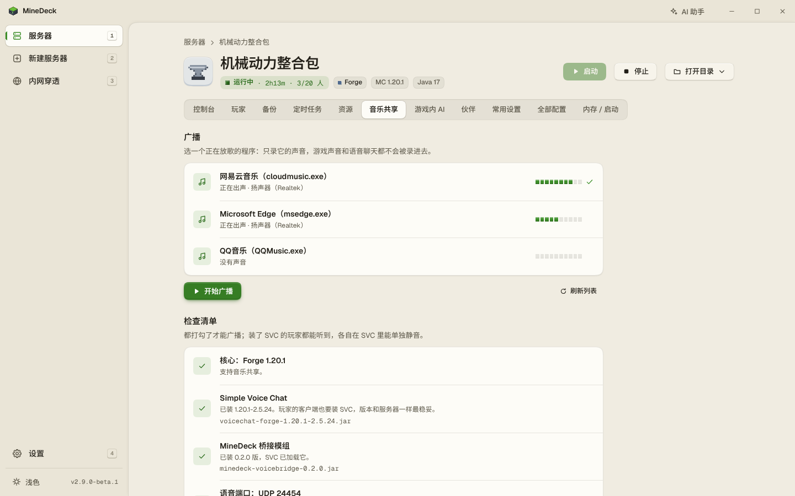
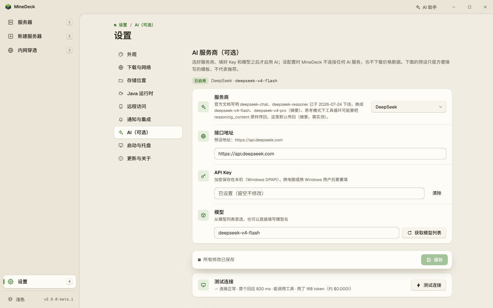

# MineDeck · 我的世界（Minecraft）一键开服工具

[](https://github.com/Trasperioooooon/MineDeck/releases/latest) [](https://github.com/Trasperioooooon/MineDeck/releases) [](LICENSE)  

Windows 上的**我的世界（Minecraft Java 版）一键开服工具**：单文件 `MineDeck.exe`（约 13 MB，零依赖），自动下载 Java 和服务端，图形界面管理服务器；整合包一键导入，内置樱花穿透、OpenFrp 内网穿透，好友异地也能联机。还可以接入自己的 AI Key：开服排错助手、游戏内 AI 问答、会跟随和砍树打怪的 AI 伙伴，以及把房主的音乐放给全服听的音乐共享。

选好版本点创建，自动完成：**匹配并下载便携式 Java → 下载服务端核心 → 运行安装器 → 同意 EULA → 生成配置与启动脚本 → 图形界面管理开服**。全程使用国内镜像加速（BMCLAPI / 清华 TUNA），官方源自动兜底。

> 异地联机：在「内网穿透」页添加樱花穿透、OpenFrp 或自定义 frps 的隧道，跟随服务器自动启动，公网地址一键复制给好友。

<p align="center"></p>

---

## ✨ 功能一览

| 能力 | 说明 |
|---|---|
| **十二种服务端核心** | Vanilla 原版 · Paper / Purpur / Leaves / Folia（插件服）· Fabric / NeoForge / Forge（模组服）· Mohist / Banner（模组+插件混合服）· Velocity / Waterfall（群组代理端） |
| **本机 Java 扫描** | 自动发现已安装的 Java（注册表/PATH/常见目录），能复用就不下载 |
| **控制台增强** | GBK/UTF-8 编码切换（老包乱码克星）、WARN/ERROR 着色、日志过滤、命令历史（↑↓） |
| **MOTD 彩色编辑器** | § 色码调色板 + 实时预览，Emoji/中文自动按规范转义 |
| **版本范围** | MC 1.12.2 → 最新（含 26.x 新版本号体系，版本列表实时从官方清单获取，未来版本自动支持） |
| **Java 全自动** | 读取 Mojang 官方 `javaVersion` 元数据精确匹配（8/16/17/21/25...），便携部署于 `runtimes/`，**不碰系统环境变量、不与已装 Java 冲突** |
| **下载三级加速** | BMCLAPI / 清华 TUNA 优先 → Adoptium/官方源 → Mojang 官方运行时，逐源故障转移 + 3 轮重试 + SHA 校验 |
| **安装器加固** | Forge/NeoForge 官方安装器自动附加 `--mirror`（BMCLAPI）、预放置原版 server.jar 跳过其直连 Mojang 的下载、失败自动重试 3 次 |
| **图形界面** | WebView2 原生窗口（缺失时自动用浏览器打开），Windows 11 风格的侧栏布局：创建向导 / 实时控制台 / 命令下发 / 配置面板；**7 套配色方案**（默认「方块」暖沙纸底 + 草绿，另有 Fluent / GitHub / 石墨 / Nord / Catppuccin / Solarized）× 浅色 · 深色 · 跟随系统，另有 8 种强调色可选，文字对比度均过 WCAG AA；界面字体随 exe 内嵌（Geist + Noto Sans SC，见下文「第三方字体与许可」），任何电脑显示一致；像素风应用图标「体素机柜」与 12 种核心头像；冷启动不白闪；高 DPI 屏清晰渲染 |
| **系统托盘与自启** | 关窗最小化到托盘（服务器不停）、托盘右键「打开面板 / 全部停止并退出」、开机自动启动（静默进托盘）——均可在「设置 → 启动与托盘」开关 |
| **存储位置自选** | 实例/备份存放目录可改到任意盘（系统文件夹选择框），多根扫描，中文实例名自动生成 ASCII 目录 |
| **贴心细节** | 首次运行引导卡、控制台命令补全（常用命令 + 在线玩家名 Tab 补全）、备份保留份数可配、`bg/` 目录放图即成个性化壁纸 |
| **整合包一键导入** | Modrinth (.mrpack) 拖入即开服（自动识别核心/版本/加载器，跳过纯客户端文件）；CurseForge zip 配 API Key 可用 |
| **内网穿透** | 接入 OpenFrp（基于 OpenFrp OPENAPI）/ 樱花frp / 自定义 frps，frpc 自动下载托管、跟随服务器启动、公网地址一键复制 |
| **运维三件套** | 世界备份/还原（运行中热备）· 崩溃自动重启（退避策略）· 每日定时重启/命令/备份 |
| **玩家管理** | 在线列表（踢出/OP）、白名单/管理员/封禁可视化（停机时直接改名单文件，离线 UUID 自动计算） |
| **资源浏览器** | 实例内直接搜索安装 Modrinth 模组/插件（按核心与版本自动过滤兼容项） |
| **远程管理** | 局域网访问开关 + 密码登录，手机躺床上管服；开放 REST API + Webhook 事件推送（见 docs/API.md） |
| **自动更新** | 检查 GitHub Releases（国内加速镜像兜底），一键换血重启 |
| **配置全量目录** | 约 60 项 `server.properties` 数据化呈现（分 7 组 + 搜索 + 中文说明 + 范围校验 + 「需重启」标注），**按 MC 版本自动显隐**（1.21.9+ 已迁移项转为 `/gamerule` 控件即时生效）；正版验证默认关、允许飞行默认开 |
| **进程托管** | 一键启停、`stop` 优雅关服（30 秒超时强杀）、启动前端口占用预检、程序退出自动停服、Job Object 兜底防止孤儿 java 进程 |
| **AI 接入（可选）** | 填自己的 API Key：OpenAI 兼容和 Claude 两种协议，内置 DeepSeek / 通义千问 / Kimi / 智谱 / OpenAI / Claude / Ollama（本机）七个预设和自定义地址；按 LiteLLM 公开价格估算费用，每个功能可设每日额度；Key 经 Windows DPAPI 加密保存；**不配置不联网** |
| **应用内 AI 助手** | 标题栏「AI 助手」：先查日志、配置、崩溃报告再回答；改配置、换 Java、重启服务器先出确认卡片，人点了才执行；发给 AI 的内容先脱敏，随时可看原文。控制台顶部的**报错横幅**用本地规则认出 13 类常见错误（少前置、客户端模组进了服务端、端口被占、Java 不对等），不需要 AI |
| **游戏内 AI** | 玩家在聊天里说 `@AI 问题`，默认全服可见；`/私` 只回自己、`/问` 只答不做、`/额度`、`/帮助`；面板里勾选的玩家可以让 AI 执行白名单里的命令（按模板逐个参数校验，op、execute 等写死禁止），搭配一键开启白名单 |
| **音乐共享** | 把房主电脑上音乐软件的声音经 Simple Voice Chat 广播给服里的人，每人可在语音设置里单独调小或静音；Windows 11 按程序录音，不录游戏声和语音；桥接模组内置，一键安装 |
| **AI 伙伴** | NeoForge 1.21.1 / Forge 1.20.1 服里放 AI 伙伴（基于 PlayerEngine）：聊天里说「@伙伴名 跟着我」「砍 10 个橡木原木」「打附近的僵尸」；禁挖区域、不许打的生物可配；好友的客户端只装一个伙伴模组 |
| **MCP 接口（可选）** | 让 Claude Desktop、Cherry Studio、Cursor、VS Code 这些支持 MCP 的 AI 工具直接用 MineDeck：查状态、看日志直接做，改配置、重启只提请求，在 MineDeck 里确认后才执行；默认关闭，只接受本机连接、要带令牌 |
| **安全防呆** | 老版本自动启用 log4shell 官方缓解方案；清除 `JAVA_HOME`/`_JAVA_OPTIONS` 等环境污染；下载文件哈希校验；本地 API 带随机令牌 |

## 📸 截图

| **AI 开服助手**：先查模组清单再找原因，要改东西先给确认卡片 | **报错横幅**：不用 AI 也能指出少装前置、客户端模组进了服务端 |
|---|---|
|  |  |
| **游戏内 AI**：聊天里 @AI 提问，授权的玩家能让它执行白名单里的命令 | **AI 伙伴**：刷出伙伴、看它在干什么，禁挖区域保护你的建筑 |
|  |  |
| **音乐共享**：选一个音乐软件，经 Simple Voice Chat 放给全服听 | **接入 AI**：七个预设，填 Key、测试连接、设每日额度 |
|  |  |

## 🚀 使用

1. 把 `MineDeck.exe` 放进一个**独立文件夹**（所有数据都存在 exe 旁边：`servers/` 实例、`runtimes/` Java、`cache/` 下载缓存；只有界面偏好存在 `%LocalAppData%\MineDeck`）。
2. 双击运行，在窗口中点「新建服务器」→ 选核心 → 选版本 → 选构建 → 勾选 EULA → 创建。
3. 创建完成后点「▶ 启动」，等控制台出现 `Done (...)!` 即开服成功。
4. 局域网玩家用 `你的内网IP:端口` 直连；异地玩家用穿透工具映射同一端口。

常见操作：
- **发命令**：实例 → 控制台 → 底部输入框（`op 玩家名`、`whitelist add 玩家名`、`say 内容`…）
- **改配置**：实例 → 常用设置（开关化）或 全部配置（全量键值）；运行中修改需重启生效
- **调内存**：实例 → 内存/启动 → 滑块
- **手动开服**：每个实例目录内有与 GUI 等效的 `run.bat`
- **命令行模式**：`MineDeck.exe -nogui -port 27333`（仅后台服务，浏览器访问日志中的 URL）

## ❓ 常见问题

### 要自己装 Java 吗？

不用。MineDeck 按 Mojang 的版本元数据挑对应的 Java（8 / 17 / 21 / 25……），下载便携版放进 `runtimes/`，不改系统环境变量；本机已经装好的 Java 能用就直接用。

### 朋友不在同一个网络，怎么连进来？

在「内网穿透」页添加樱花穿透、OpenFrp 或自定义 frps 的隧道，绑定服务器并打开「跟随实例启动」，开服后把公网地址发给朋友。同一个局域网的朋友直接连 `你的内网IP:端口`。

### 支持哪些版本和核心？

MC 1.12.2 到最新版（含 26.x 起的年份版本号），12 种核心：原版、Paper、Purpur、Leaves、Folia、Fabric、NeoForge、Forge、Mohist、Banner、Velocity、Waterfall。Modrinth（`.mrpack`）和 CurseForge（zip）的整合包可以直接导入。

### 服务器起不来、报错看不懂怎么办？

看控制台顶部的报错横幅，它会说明原因，比如少装前置模组、客户端模组放进了服务端、端口被占、Java 版本不对，这一步不需要 AI。接入 AI 以后，可以点「让 AI 分析」，或者在「AI 助手」里直接问。

### AI 功能要花钱吗？会不会偷偷联网？

AI 是可选的，用你自己的 API Key，费用按服务商的价格付给服务商。MineDeck 会估算每次的花费，每个功能都能设每日额度。不配置 AI 就不会连任何 AI 服务；Key 用 Windows 的 DPAPI 加密保存。

### AI 会不会乱改我的服务器？

不会自己动手。读日志、看配置这类操作直接做；改配置、换 Java、重启这类操作只生成确认卡片，你点了确认才执行，所有操作都记在 `logs\ops\`。游戏内 AI 默认只回答问题，只有你勾选的玩家才能让它执行命令，而且只限白名单里的命令，`op`、`execute` 这类一律不执行。经 MCP 接口连进来的外部 AI 工具也一样：只能读，要改东西都得你在 MineDeck 里确认。

### AI 伙伴和音乐共享，好友要装什么？

- AI 伙伴：好友的客户端只装伙伴模组，发布页有下载。
- 音乐共享：服务器和好友都装同一版本的 Simple Voice Chat，桥接模组由 MineDeck 装进服务器。

### 数据存在哪？怎么卸载？

数据都在 exe 所在的文件夹里，只有界面偏好存在 `%LocalAppData%\MineDeck`。卸载就是删掉这两个文件夹。

### Windows 提示「已保护你的电脑」？

exe 没有数字签名，点「更多信息 → 仍要运行」即可。源码公开（MIT），也可以自己构建（见下文）。

## 🔧 从源码构建

需要 Go 1.25+（Windows）：

```powershell
$env:GOPROXY = 'https://goproxy.cn,direct'   # 国内加速
go build -trimpath -ldflags="-s -w -H windowsgui" -o MineDeck.exe .
```

调试版（带控制台日志）：`go build -o minedeck-cli.exe .` 后运行 `minedeck-cli.exe -nogui`。

界面字体子集（`internal/web/ui/fonts/`）和 exe 图标资源（`rsrc_windows_amd64.syso`）都已入库，构建时不需要 Python 或其他工具。改了界面文案要检查字体子集（见 [`tools/fonts/README.md`](tools/fonts/README.md)），换了 `assets/icon.ico` 要重新生成 syso（命令见 `design-system/MASTER.md` §7）。

## 🏗️ 架构

```
main.go / tray_windows.go / dpi_windows.go / webviewbg_windows.go
            入口：HTTP 服务 + WebView2 窗口/浏览器回退 + 系统托盘（关窗最小化）+ DPI 感知 + 冷启动底色 + 优雅退出
internal/
├── app/       基础目录与全局配置（下载源策略、内存探测、多存储根）
├── autostart/ 开机自启（读写 HKCU\...\Run，每用户免管理员）
├── dl/        多源故障转移下载器（重试/看门狗/SHA-1/256/MD5/原子落盘）
├── mcsrc/     12 核心版本源注册表：Mojang 清单(BMCLAPI 镜像)、Forge、NeoForge、
│              Fabric Meta、Paper Fill v3、Purpur、Mohist、FastMirror 聚合…
├── java/      便携 Java 三级下载链 + 本机 Java 扫描复用
├── inst/      实例：创建流水线、安装器托管、run.bat 生成、server.properties
│              保序读写、进程状态机、控制台环形缓冲 + 订阅、备份/策略/玩家
├── modpack/   整合包解析（Modrinth .mrpack / CurseForge zip）
├── tunnel/    内网穿透（OpenFrp / 樱花frp / 自定义 frps，frpc 托管；游戏 TCP / 语音 UDP）
├── ops/       操作层：所有界面和 AI 发起的操作统一经这里（参数说明、风险等级、提案与确认、操作记录）；具体操作在 ops/catalog
├── secret/    DPAPI 加密保存密钥（CurseForge Key、穿透凭据、AI Key）
├── mclog/     服务器日志解析（进服、退服、聊天，防伪造）
├── ai/        AI 接入层：OpenAI 兼容 / Claude 协议（自己发 HTTP、解析 SSE）、预设、价格、记账与额度
├── assistant/ 应用内 AI 助手（会话、工具映射、提案流程、上下文打包与脱敏）
├── diag/ modinfo/  报错规则（报错横幅的数据来源）、jar 里的模组信息解析
├── chatai/    游戏内 AI（认聊天、提问选项、命令白名单、tellraw 回复）
├── music/ musicshare/ bridge/   音乐共享：WASAPI 采集、广播与检查清单、SVC 桥接模组的协议客户端和内置 jar
├── companion/ AI 伙伴：伙伴模组的协议客户端、安装（Modrinth，sha512 校验）、管理器和内置 jar
├── tasks/     后台任务进度 + 结构化告警（供前端轮询）
├── events/ webhook/ update/   事件总线、Webhook 推送、GitHub 自动更新
├── web/       REST API + SSE 控制台流 + go:embed 前端（ui/ 多配色 SPA，配色令牌见 themes.css，内嵌字体在 ui/fonts/）
└── themes/    配色方案对比度测试（go test ./internal/themes/，校验 themes.css）
tools/ui-dev/  前端仿真后端 + 交互回归测试 + 截图（Node + Playwright，不需要 Windows，见其 README）
tools/fonts/   内嵌字体的子集生成脚本（Python + fontTools，手动运行，产物入库）
tools/promo/   README 截图和社交预览图的生成脚本（在仿真后端上拍真实界面，用法见脚本开头）
bridge/voicechat/  音乐共享的 SVC 桥接模组源码（javac 构建，产物入库在 internal/bridge/jar，见其 README）
companion/     AI 伙伴模组源码（NeoForge 1.21.1 / Forge 1.20.1，Gradle 构建，产物入库在 internal/companion/jar，见其 README）
assets/        应用图标 icon.ico（像素画逐尺寸绘制）；界面设计规范见 design-system/MASTER.md
```

关键设计决策见 `docs/MC自动化开服技术实现方案与版本映射表.md`（含实测验证过的版本映射与下载源矩阵）。

## 📋 版本 ↔ Java 对照（自动处理，无需记忆）

| MC 版本 | Java | 服务端可选核心 |
|---|---|---|
| 1.12 – 1.16.5 | 8 | Vanilla / Paper / Purpur(1.14+) / Forge / Fabric(1.14+) |
| 1.17.x | 16 | 同上 |
| 1.18 – 1.20.4 | 17 | 同上 |
| 1.20.5 – 1.21.x | 21 | + NeoForge(1.20.2+) |
| 26.1+（年份版本号） | 25 | Vanilla / Paper / Purpur / Fabric / NeoForge |

*实际以 Mojang 版本元数据的 `javaVersion.majorVersion` 为准，上表仅为离线兜底。*

## 🔤 第三方字体与许可

界面内嵌三款开源字体（经 `go:embed` 打包进 exe，运行时不联网下载），均为 [SIL Open Font License 1.1](https://openfontlicense.org/)：

| 字体 | 用途 | 版权 | 来源 |
|---|---|---|---|
| **Geist** | 西文正文、数字 | Copyright 2024 The Geist Project Authors | Vercel 官方 npm 包 `geist@1.8.2`（[vercel/geist-font](https://github.com/vercel/geist-font)） |
| **Geist Mono** | 控制台、路径、端口等等宽文字 | 同上 | 同上 |
| **Noto Sans SC** | 中文 | © 2014-2021 Adobe，保留字体名「Source」 | [google/fonts](https://github.com/google/fonts) 的 `ofl/notosanssc`（与思源黑体同源） |

- 三款字体都是子集：西文保留拉丁字符与常用符号，中文保留 GB2312 全部 6763 个汉字、GB2312 符号区与界面用到的全部字符；字重轴限制在 400–600。子集之外的生僻字由系统字体（微软雅黑等）补上。
- 子集化属于 OFL 允许的修改。子集保留了字体内的版权与许可信息，许可原文随字体放在 [`internal/web/ui/fonts/`](internal/web/ui/fonts/)（`OFL-Geist.txt`、`OFL-NotoSansSC.txt`）。字体不单独出售；修改后的字体名不含保留字体名「Source」。
- 子集由 [`tools/fonts/build_fonts.py`](tools/fonts/) 从固定版本的源文件生成，来源、校验和与字符集构成见 [`tools/fonts/README.md`](tools/fonts/README.md)。

## ⚠️ 已知边界

- Paper / Purpur 官方 API 无国内镜像（Cloudflare 直连一般可用）；Forge/NeoForge 安装器的部分依赖库下载仍需可访问官方 maven（已用 `--mirror` + 重试缓解）。
- 首次启动某实例时 Windows 防火墙可能弹窗，请选择「允许访问」，否则局域网玩家无法连接。
- 删除 `runtimes/` 会导致已建实例无法启动（重新创建实例即可自动补全）。

## English

MineDeck is a one-click Minecraft (Java Edition) server launcher for Windows. It is a single ~13 MB executable (Go + WebView2) that picks and downloads the right Java runtime and server software (Vanilla, Paper, Purpur, Fabric, Forge, NeoForge, Mohist and more), imports Modrinth and CurseForge modpacks, and manages servers through a GUI: console, players, backups, scheduled restarts, and built-in frp tunnels (SakuraFrp, OpenFrp, self-hosted frps) so friends can join from anywhere.

Optional AI features use your own API key (OpenAI-compatible or Claude protocol; presets for DeepSeek, Qwen, Kimi, Zhipu, OpenAI, Claude and Ollama):

- an in-app assistant that reads logs and configs to troubleshoot, and proposes changes that run only after you confirm them;
- in-game AI: players ask `@AI ...` in chat, and players you authorize can have it run allowlisted commands;
- AI companions built on PlayerEngine (NeoForge 1.21.1 and Forge 1.20.1) that follow players, gather wood and fight mobs;
- music sharing: stream the host's music player to everyone on the server through Simple Voice Chat;
- an MCP server (off by default), so AI tools on the same PC such as Claude Desktop, Cherry Studio, Cursor or VS Code can read MineDeck's state and propose changes that run only after you confirm them in the app.

The interface is Chinese only for now. MIT licensed.
